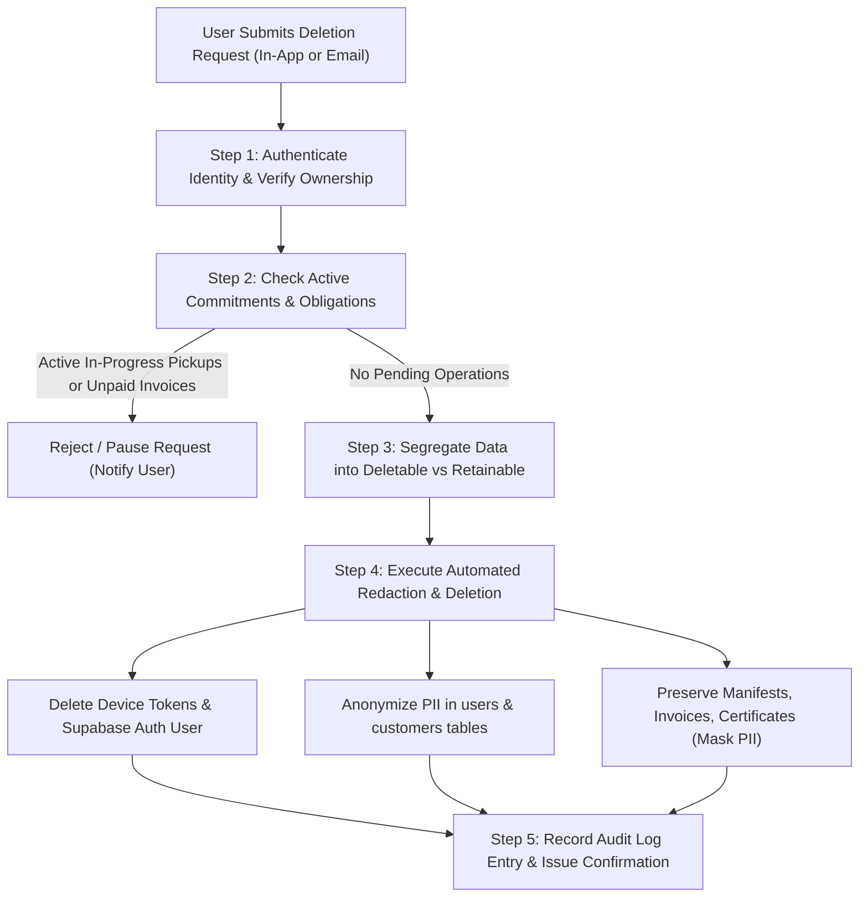

# PHARMATRIX DATA DELETION AND DATA SUBJECT RIGHTS (DSR) STANDARD OPERATING PROCEDURE

**Document Reference:** PMX-SOP-DSR-2026  
**Version:** 1.0.0  
**Effective Date:** November 14, 2026  
**Status:** Approved for Technical & Operational Execution  

---

## 1. Purpose and Legal Framework
This Standard Operating Procedure ("**SOP**") establishes the end-to-end operational and technical protocol for handling **Data Subject Rights ("DSR")** / **Data Principal Rights** submitted by users of the Pharmatrix Platform, specifically addressing:
1. **Right to Access & Data Portability** (Section 11, DPDPA 2023 / Art. 15 & 20 GDPR);
2. **Right to Correction & Rectification** (Section 12, DPDPA 2023 / Art. 16 GDPR);
3. **Right to Erasure / Deletion** (Section 12, DPDPA 2023 / Art. 17 GDPR);
4. **Right to Withdraw Consent** (Section 6(4), DPDPA 2023 / Art. 7(3) GDPR).

---

## 2. The Statutory Retention Conflict (Critical Compliance Safeguard)

> [!IMPORTANT]
> Under Indian law, an unconditional "Right to Erasure" **cannot override statutory record retention mandates**.
> 
> Specifically:
> - **Bio-Medical Waste Management Rules, 2016 (Rule 13):** Mandatory 5-year preservation of waste generation, collection, and handover manifests.
> - **Central Goods and Services Tax Act, 2017 (Section 36):** Mandatory 72-month retention of tax invoices, credit notes, and payment ledgers.
> - **Income Tax Act, 1961:** Mandatory 8-year record retention.
> 
> **Resolution:** Pharmatrix applies **Selective Anonymization and Pseudo-De-identification** rather than unrestricted cascading database deletion (`ON DELETE CASCADE`). Financial, tax, manifest, and chain-of-custody records are preserved with PII redacted/masked, while non-essential credentials, device tokens, and contact lists are permanently expunged.

---

## 3. Step-by-Step Data Erasure Workflow



### Detailed Workflow Steps:

### Step 1: Authentication & Verification
- **In-App Request:** If submitted via the Customer Mobile App (`POST /api/compliance/data-deletion`), identity is cryptographically verified via the user's active Bearer JWT token.
- **Email / Manual Request:** If submitted to `privacy@pharmatrix.com`, the requester must provide:
  - Account registered email address;
  - Customer Code (`CUST-XXXXXX`);
  - Copy of authorized signatory government ID or business registration certificate.

### Step 2: Conflict & Operational Check
Before approving deletion, the system / compliance officer verifies that:
1. There are **no active pickups** in state `REQUESTED`, `SCHEDULED`, `ASSIGNED`, or `IN_PROGRESS`;
2. There are **no unpaid invoices** with outstanding balances;
3. There are **no open regulatory exceptions or environmental investigations**.
*If any of the above exist, the deletion request is placed on hold and the user is notified with specific resolution requirements.*

### Step 3: Deletion vs. Retention Partitioning
The system classifies user records into two buckets:

| Bucket A: Immediate Hard Deletion | Bucket B: Statutory Retention & Anonymization |
|---|---|
| Active session tokens and refresh tokens | Historical Pickup records (`pickups` table - code, weight, date retained) |
| Device Push Notification Tokens (`device_tokens`) | Warehouse intake records & item lists |
| Direct marketing preferences | Invoices, Line Items, and Razorpay payment reference records |
| Physical location access photos and notes | Disposal shipment manifests and CBWTF destruction certificates |
| Unverified temporary documents | System audit trails (`audit_logs`) |

### Step 4: Technical Deletion & Redaction Execution
Upon approval, the automated DSR endpoint executes the following operations in a single database transaction:
1. **User Table Redaction:**
   ```sql
   UPDATE users SET
       name = 'Anonymized User',
       email = 'deleted_' || id || '@redacted.pharmatrix.internal',
       is_active = false
   WHERE id = :target_user_id;
   ```
2. **Customer Table Redaction:**
   ```sql
   UPDATE customers SET
       legal_name = 'Anonymized Pharmacy Entity',
       display_name = 'Redacted Customer',
       phone = '+91-0000000000',
       email = NULL,
       gst_number = 'ANONYMIZED_GST',
       is_active = false
   WHERE user_id = :target_user_id;
   ```
3. **Customer Location Redaction:**
   ```sql
   UPDATE customer_locations SET
       address_line_1 = 'Redacted Address',
       address_line_2 = NULL,
       contact_name = 'Redacted',
       contact_phone = NULL,
       location_photo = NULL
   WHERE customer_id = :customer_id;
   ```
4. **Device Token Elimination:**
   ```sql
   DELETE FROM device_tokens WHERE user_id = :target_user_id;
   ```
5. **Supabase Auth Deletion:**
   The admin client calls `admin_client.auth.admin.delete_user(auth_user_id)` to permanently remove authentication credentials from Supabase GoTrue.
6. **Customer Documents Purge:**
   Regulatory documents uploaded in Supabase Storage bucket `customer-documents` are purged unless a legal hold applies.

### Step 5: Audit Logging and User Notification
- An immutable audit log entry is generated in `audit_logs` recording action `USER_DATA_DELETION_EXECUTED` with actor ID, timestamp, and redacted summary.
- A formal Confirmation of Deletion receipt is dispatched to the user's original email address documenting what was deleted and what was statutory-anonymized.

---

## 4. Data Portability / Export Procedure
1. When a user requests an export (`GET /api/compliance/data-export`), the system compiles a complete machine-readable JSON archive containing:
   - Profile information;
   - Location entries;
   - Complete historical pickup summary (dates, codes, weights, statuses);
   - Invoices and payment transaction records;
   - Active consent history and marketing settings.
2. The export payload is generated on demand and returned via authenticated HTTPS download.

